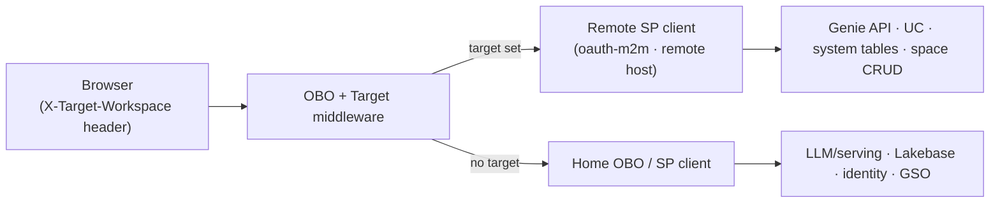

# Cross-Workspace

Genie Workbench is deployed in one **home** workspace but can **deploy, score, and monitor** Genie Agents in other (**remote**) workspaces. Auto-Optimize (GSO) always runs in the home workspace.

## How it works

A user's OBO token and the app's own Service Principal (SP) are both scoped to the home workspace, so a remote workspace is reached with its **own service-principal OAuth (M2M) credentials**. Each remote workspace is registered as a *connection* (Admin → Workspaces). When a remote workspace is selected in the header switcher, the browser sends an `X-Target-Workspace: <id>` header; middleware resolves it to a cached remote `WorkspaceClient`, and the workspace-scoped accessors return that client for the request.



**Home vs target split.** These always stay on the home workspace, regardless of the selected target:

- **LLM / serving inference** and model catalog (the remote workspace may not host the same endpoints).
- **Lakebase persistence** and the **secret scope** holding connection credentials.
- The **caller's identity** (`/api/auth/me`).
- **Auto-Optimize (GSO)** — its job, Unity Catalog tables, and warehouse live in home; the API returns `400` if invoked while a remote target is selected, and the Optimize tab is hidden in the UI.

Everything else — listing/fetching Genie Agents, IQ scan config + Unity Catalog enrichment, space creation, and GenieWatch system-table reads — follows the selected target.

### Credential storage

Connection metadata (name, host, client_id) and a **secret-scope reference** are stored in Lakebase (`genie.workspace_connections`). The SP **client secret itself** is stored in a Databricks **secret scope** in the home workspace (`genie-workbench-workspaces`, one key per connection) — never in the app database. The `scripts/grant_permissions.py` step ensures the scope exists and grants the app SP `MANAGE`; the app also creates it at runtime as a fallback.

## Registering a remote workspace

1. In the remote workspace, create (or choose) a **service principal** and generate an **OAuth secret** (client ID + secret) for it.
2. In Genie Workbench: **Admin → Workspaces → Add workspace**. Enter a display name, the remote workspace **host** (`https://…`), and the SP **client ID** + **secret**. The credentials are validated against the remote workspace before the connection is saved.
3. Select the workspace from the **header switcher**. The page reloads and all views query the remote workspace.

Connection status:

- **active** — authenticated and system tables are readable (monitoring will work).
- **active_no_system_tables** — authenticated, but the SP can't read system tables (deploy/score work; monitoring panels stay empty).
- **error** — authentication failed. Use **Test** to re-probe.

## Remote prerequisites per capability

Cross-workspace access runs **only as the remote SP** (there is no cross-workspace user identity), so grant that SP what each capability needs **in the remote workspace**:

| Capability | Remote SP needs |
|---|---|
| **Deploy** (create agent) | Ability to create Genie Agents; a target directory. LLM runs on home. |
| **Score** (IQ scan) | `CAN VIEW`/`CAN EDIT` on the agents you want to list/score; `SELECT` on the upstream UC tables for metadata enrichment. |
| **Monitor** (Cost/Feedback/Resources) | System-table grants (below) **and** `CAN USE` on a SQL warehouse in the remote workspace (the app auto-selects one there to run the queries). |

:::note Agents not showing up?
The top-nav **Agents** list only shows agents the **remote SP** can see. If your agent is owned by you (not the SP), share it with the SP (`CAN VIEW`/`CAN EDIT`) in the remote workspace, then Refresh.
:::

### System-table grants for monitoring

Run these in the **remote** workspace (as a metastore admin there), substituting the remote SP's client ID — this is the same set `grant_permissions.py` applies for the home workspace:

```sql
GRANT USE CATALOG ON CATALOG system                         TO `<remote-sp-client-id>`;
GRANT USE SCHEMA  ON SCHEMA  system.query                   TO `<remote-sp-client-id>`;
GRANT USE SCHEMA  ON SCHEMA  system.billing                 TO `<remote-sp-client-id>`;
GRANT USE SCHEMA  ON SCHEMA  system.access                  TO `<remote-sp-client-id>`;
GRANT SELECT      ON TABLE   system.query.history           TO `<remote-sp-client-id>`;
GRANT SELECT      ON TABLE   system.billing.usage           TO `<remote-sp-client-id>`;
GRANT SELECT      ON TABLE   system.billing.list_prices     TO `<remote-sp-client-id>`;
GRANT SELECT      ON TABLE   system.access.audit            TO `<remote-sp-client-id>`;
GRANT SELECT      ON TABLE   system.access.table_lineage    TO `<remote-sp-client-id>`;
GRANT SELECT      ON TABLE   system.access.workspaces_latest TO `<remote-sp-client-id>`;
```

:::note Empty cost with no error
Monitoring reports SQL-warehouse compute attributed to **Genie query activity**. If an agent has been created/scanned but not actually *used* to run queries, the Cost tab is legitimately zero. Query counts and distinct users appear within minutes of real usage; the cost estimate (`system.billing.usage`) can lag a few hours due to the billing pipeline.
:::

## State and isolation

All persisted state (scan history, stars, optimization runs, watch caches) lives in the **home** Lakebase. Genie Agent IDs are globally unique, and admin/list views intersect stored rows with the active workspace's live Genie Agent list, so home and remote data stay separated in the UI without per-row workspace tagging.

## Notes

- The switcher selection persists in `localStorage` and is applied before the first request after a reload.
- Connection management (`/api/workspaces/*`) always runs against home (secrets + Lakebase), never the selected target.
- Registering, editing, and removing connections is **admin-only** (workspace `admins` group, verified via SCIM).
